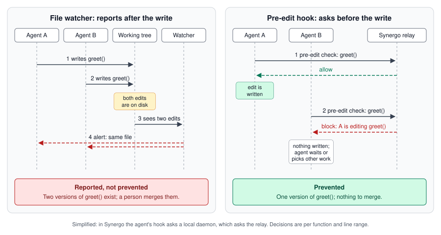

# Why file watchers can't prevent agent conflicts

*Draft. Publish on D-7 (see the launch checklist). Image:
[../assets/watcher-vs-hook.svg](../assets/watcher-vs-hook.svg).*

Hivelane started as a file watcher. At a hackathon we wanted a live board of
what every teammate's AI agent was doing, so each laptop ran a small process
that watched the working tree, diffed every saved file and sent the diff to
a shared board. When two people's changes touched the same file within a
short window, the board showed a conflict banner.

It worked as a board. As a way to stop collisions, it never could, and the
reason is structural rather than a matter of tuning. This post explains why,
and what we replaced it with.

## A watcher sees an edit after it exists

A file watcher learns about a change from the filesystem: an inotify or
FSEvents notification, or a poll that notices a new modification time. In
every case the change is already written. That is fine for a build tool,
which only needs to react. It is the wrong moment for coordination.

Walk through the collision a watcher is supposed to catch:

1. Agent A rewrites `greet()` in `src/hello.py`. The file changes on disk.
2. A few seconds later, Agent B, working from its own prompt, rewrites
   `greet()` too. The file changes again, in B's checkout.
3. The watchers notice and report: two people changed `src/hello.py`.
4. Both agents get an alert, or more likely their humans do.



By step 3 there are two versions of `greet()`. The alert is accurate and too
late: the only remaining move is a merge, by a person, who has to understand
both changes. Making the watcher faster does not help. A one-second poll (the
interval our observe-only watcher still uses) shortens the gap between the
write and the alert, but the write still comes first.

Agents make this worse than it is with humans. A person types for minutes
before saving; an agent writes a whole function in one tool call, then moves
to the next file. By the time anyone reads an alert, the agent has usually
built three more changes on top of the one that collided.

## A watcher sees files, not functions

The second problem is resolution. A watcher sees that a file changed. Without
extra work it does not know which function changed, and it never knows which
function the agent is *about* to change. So most watchers alert at file
level: two agents in unrelated functions of a 2,000-line module raise the
same alarm as two agents in the same function.

That has a cost beyond annoyance. An alert that is usually noise trains
people to ignore it, which is how a real collision gets ignored too. When we
replayed a set of synthetic two-agent sessions through a file-level rule, 10
of its 23 blocks were false (the benchmark is described in
[How Hivelane decides](how-hivelane-decides.md)).

## A watcher talks to the wrong party

A watcher's alert goes to a person: a desktop notification, a banner on a
board. The party that could act on it immediately is the agent that is about
to make the next edit, and a watcher has no channel to it. Even a perfect
alert has to wait for a human to read it, interrupt the agent and explain.

## What a pre-edit hook changes

Every agent that Hivelane can block (Claude Code, Codex CLI, Cursor and
Gemini CLI) exposes hooks: commands the agent runs at fixed points, with a
JSON description of what is about to happen on stdin, and a way to answer.
The one that matters is the hook that runs **before a file edit**. It changes
all three problems.

**Timing.** The hook runs before the write. `hivelane hook <agent>` asks a
local daemon, which asks a shared relay whether a teammate's agent recently
edited, or is planning to edit, the same code. If the answer is block, the
agent's edit tool call is denied and the file is never written. There is
nothing to merge.

**Resolution.** The hook's input includes the edit itself. For a
string-replacement edit (Claude Code's `Edit`, Gemini CLI's `replace`) that
is the old and new text, so the daemon can work out which lines, and which
functions, the edit is about to touch, before it happens. The relay then
compares functions and line ranges, not file names. Two agents in different
functions of one file get a warning and both carry on; only the same
function, or overlapping lines, blocks.

**Audience.** The hook answers the agent directly, in its own response
format. A blocked Claude Code agent reads:

```text
Hivelane: alice's claude-code is editing greet in src/hello.py (14s ago) — wait, or pick another file (their task: "Add a greeting parameter to greet()")
```

The agent can act on that sentence: wait, or move to other work. Its human
sees it too. Nobody has to interrupt anybody.

Hooks also see more than edits. A prompt hook shares what the agent was just
asked to do, and Claude Code's plan and todo-list tools share what it intends
to touch next, so a teammate's agent can be warned before either side has
edited anything.

## What a hook has to get right

Putting a check in front of every edit raises the bar for the check.

- **It must be fast.** The agent starts the hook as a new process on every
  file write. Hivelane's hook imports only the standard library, and the test
  suite fails if anything heavier creeps in. Measured with
  `scripts/bench_hook.py` against a local stub daemon, p95 is 117 ms on
  Windows (it was 1,665 ms before the hook path was stripped down). A check
  waits at most 1.5 s for the relay.
- **It must fail open.** If the daemon or the relay is unreachable, or
  anything in Hivelane throws, the edit goes ahead and the agent shows a
  "Hivelane offline" notice at most once every ten minutes. A coordination
  tool that can stall your agent is worse than none.
- **A warning must not approve anything.** Several agents treat an explicit
  "allow" from a hook as approval that skips the user's own confirmation. A
  Hivelane warning only adds a message; the agent's normal permission flow
  still runs.
- **It must not take over the config file.** Install merges Hivelane's
  entries into the agent's existing hook config, finds them later by the
  `hivelane hook` command they run, leaves everything else alone, and refuses
  to touch a file it cannot parse.

## Where watchers still belong

Hooks only exist where agents offer them. A watcher works for anything that
writes to disk, which is why Hivelane keeps one: `hivelane run aider` and
`hivelane watch` share edits from agents without pre-edit hooks, and the
editor extension shares humans' saved edits. Those paths are honest about
what they are: observe-only. They make the board complete and they warn, but
they cannot stop an edit, for all the reasons above.

Hooks have limits of their own. An edit made through a shell command, rather
than the agent's edit tool, never passes a pre-edit hook. Decisions work on
recent activity (by default, a teammate's edit in the last 20 seconds can
block, in the last 60 seconds warns), so they can warn about work that would
have merged cleanly, and they do not see a conflict between changes made
hours apart. And everything depends on a relay the team can reach and trust,
which is why the relay is a small process you can run yourself, with an
end-to-end encrypted mode that leaves it only hashes.

The trade is still clear. A watcher can tell you a collision happened. A
pre-edit hook can make sure it does not.

---

Hivelane is open source (Apache-2.0):
[github.com/AdrianShah/Hivelane](https://github.com/AdrianShah/Hivelane).
`hivelane up` in a repo installs the hooks for the agents it finds.
